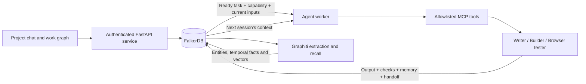

# Relay

**An AI project team that performs work, shares evidence and resumes across sessions.**

Graph Hacks submission: **Track 02 — Agent Memory and Coordination**.

An agent conversation usually ends with a plan and loses useful context when the next person or session takes over. Relay turns a project plan into a persistent work graph. Agents create real outputs, pass those outputs to the next agent, and remember what happened. A person approves task execution and reviews completion.

**[Watch the three-minute demo](docs/demo.mp4)** · [Complete setup](docs/LOCAL_SETUP.md) · [Graph model](docs/GRAPH_MODEL.md) · [Cypher and algorithms](docs/CYPHER_QUERIES.md)

## What you can do

- Create a project with tasks and dependencies, or upload a plan generated in [Automate](https://github.com/ayushmanthehero-lab/Automate).
- Approve a ready task in project chat. FalkorDB selects its prerequisites and the agent with the required capability.
- Inspect the generated files, validation checks, agent, session and source inputs.
- Close and reopen the app without losing conversations, committed outputs or handoffs.
- Request a revision through chat. Relay creates a fresh project attempt and keeps the earlier outputs as history.
- Explore dependencies, agent workflows and evidence in the work graph; review the AI's recommendation and approve or reject completion yourself.

The installed agents produce **general Markdown documents** and a **local signup-page prototype**: requirements, a JSON contract, HTML, real Playwright browser checks and a local release bundle. They do not build arbitrary applications or deploy services. The project chat's status mode reports saved graph state; the revision mode updates task requirements for another approved run.

## Start locally

Requirements: **Python 3.13**, Docker with Compose, and a live model provider for task execution. The checked-in frontend runs without Node.js.

```powershell
git clone https://github.com/ayushmanthehero-lab/Relay.git
Set-Location Relay
Copy-Item .env.example .env
```

For the host's authenticated Codex CLI, first install and sign in to Codex normally on this computer, then run:

```powershell
codex login
./scripts/start.ps1 -Provider codex
```

Open **http://127.0.0.1:8091** and choose a local sample identity. FalkorDB runs on **6381**; its Browser is at **http://127.0.0.1:3002**. The launcher creates the virtual environment, installs requirements, starts the database and runs Relay.

**[Complete local setup](docs/LOCAL_SETUP.md)** includes macOS/Linux, API and Ollama providers, Graphiti embeddings, a full Docker deployment, authentication, persistence and troubleshooting. `MODEL_PROVIDER=demo` is a labeled walkthrough and **cannot execute tasks**; a fresh clone does not contain somebody else's projects or credentials.

## Try a complete project

1. Open **Projects → New project**. Describe a synthetic customer onboarding project.
2. Add a Writer task: “Write a welcome brief with a first-week checklist.” Add another Writer task: “Write the onboarding handoff using the welcome brief,” and select the first task under **Run after**.
3. Create the project. Importing or creating it starts no agents.
4. In its chat, click **Approve & run task** on the first task. Inspect the actual saved Markdown output and its checks.
5. Approve the second task. Its agent receives the saved first output through a graph-recorded handoff.
6. Reopen Relay and inspect the same project, outputs and history. Use **Review completion** to record a separate human decision.
7. Choose **Request revision**, select a task and describe the change. The new attempt requires fresh approvals for **all** tasks; earlier attempts remain accessible.

For a dependency-reasoning demonstration, the recovery case tools compare depth one and four, explain a shortest dependency path, and rank project bottlenecks. Unknown work items produce an explicit missing-evidence result. These investigative tools complement the actual execution workflow.

## Why FalkorDB is central

The graph does the scheduling and remembers the work; it is not a diagram drawn over another database.



| Track requirement | Relay's implementation |
| --- | --- |
| Episodic memory | Dated execution and resolution episodes linked to artifacts and sessions. |
| Semantic memory | Sourced native facts plus optional Graphiti extraction and hybrid recall in FalkorDB. |
| Procedural memory | Versioned playbooks proposed from outcomes; a human approves them before reuse. |
| Persistent history | Conversations, project versions, outputs and decisions survive application restarts. |
| Shared state and handoffs | Agents consume the exact saved prerequisite artifacts and record which handoff they used. |
| Concurrent coordination | Persisted jobs, leases, conditional commits and revision checks prevent stale workers from publishing results. |
| User and tenant isolation | A native graph per tenant, scoped Graphiti graphs and server-enforced private/team access. |

There is **no SQLite, external vector database or JSON-state fallback**. Removing FalkorDB stops project loading, scheduling, memory and history; database failure returns HTTP 503. Graphiti is an optional retrieval enhancement, while the native FalkorDB workflow is required. Worker concurrency spans projects; each case permits one active job, and graph writes are serialized by FalkorDB.

## Graph data model and queries

The native graph `relay_support_<tenant>` contains:

```text
Project ─HAS_PLAN→ ProjectPlan ─IMPLEMENTED_AS→ Case
Case ─HAS_ITEM→ WorkItem ─DEPENDS_ON→ prerequisite WorkItem
WorkItem ─REQUIRES_CAPABILITY→ Capability ←HAS_CAPABILITY─ Agent
ProjectStartApproval ─AUTHORIZES→ WorkItem
Agent ─ASSIGNED→ Task ←EXECUTES─ Job
Task ─IMPLEMENTS→ WorkItem
Task ─PRODUCED→ ExecutionArtifact ─USED_INPUT→ earlier ExecutionArtifact
Handoff ─CARRIES→ ExecutionArtifact
WorkSession ─CONTAINS→ ExecutionArtifact
ExecutionArtifact ─RECORDED_AS→ Episode ←DERIVED_FROM─ Memory
TaskReview ─USES_EVIDENCE→ ExecutionArtifact
TaskDecision ─DECIDES→ Task
```

Graphiti keeps shared knowledge in `relaykg_<tenant>_team` and private knowledge in `relaykg_<tenant>_user_<owner-hash>`. The server derives these names from the authenticated principal. Assignment metadata in an imported plan does not grant access.

- **[Full graph data model](docs/GRAPH_MODEL.md)** — labels, relationships, scopes, status and provenance.
- **[Cypher queries and algorithms](docs/CYPHER_QUERIES.md)** — actual readiness traversal, capability matching, memory recall, shortest path, PageRank and guarded writes, with source links.
- **[Workflow architecture](docs/ARCHITECTURE.md)** — imports, workers, MCP, recovery and the optional Automate bridge.
- **[Complete local setup](docs/LOCAL_SETUP.md)** — reproducible commands and configuration.

## Optional Automate connection

Relay works independently. Automate can generate a versioned plan, send it through Relay's authenticated project API, and read the scoped Company Brain export. Relay returns the source plan, declared owners, work, outputs and human decisions so Automate can connect them to its company map. The apps use separate FalkorDB instances by default and exchange data through HTTP, not sibling imports or shared credentials.

## Implementation and disclosure

Python/FastAPI, the official FalkorDB Python client, native Cypher and algorithms, Graphiti with its FalkorDB driver, the MCP Python SDK, Playwright and the locally bundled official FalkorDB Canvas component. Dependency manifests and the Canvas build script are included; third-party notices remain with the bundled assets.

Built with **OpenAI Codex AI coding assistance**. Sample scenarios are synthetic. Model-generated work is exposed for inspection; AI review never substitutes for human completion approval. The participant is responsible for understanding and verifying the submitted implementation.
