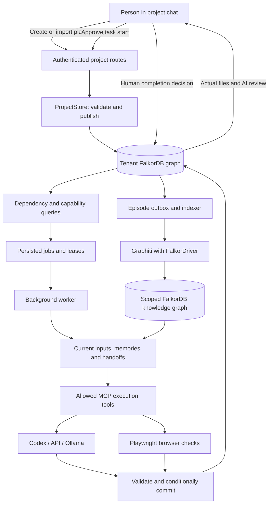

# Workflow architecture

Relay is a standalone FastAPI application serving a static browser UI and background agent workers. FalkorDB supplies authoritative work state, memory, provenance and coordination. A live model supplies reasoning and bounded document/code generation. There is no alternate application database.

## 1. A plan becomes a project

[`project_models.py`](../relay_app/project_models.py) defines the portable schema: title, description, assumptions, tasks, owners, acceptance criteria, dependencies and source provenance. It validates bounds and the dependency DAG. [`project_store.py`](../relay_app/project_store.py) atomically creates the `Project`, immutable plan version, recovery case, work items, capabilities, dependencies, initial session and chat receipts.

Creating/importing never enqueues execution. Duplicate identical imports are idempotent; conflicting versions fail. Human owner fields are attribution metadata, not authorization. The authenticated actor controls scope.

## 2. The graph determines eligible work

**Approve & run task** records start consent for the current plan and task. [`execution_store.py`](../relay_app/execution_store.py) traverses all prerequisites through `DEPENDS_ON*1..40`, checks current successful outputs and finds an available agent through `REQUIRES_CAPABILITY ← HAS_CAPABILITY`.

The selected item, agent and exact input artifacts become a persisted job. Handoffs link the producing artifacts to the receiving job. A downstream task remains waiting until its prerequisites and its own start consent are valid.

## 3. Agents perform bounded tasks

[`support_worker.py`](../relay_app/support_worker.py) runs persisted work for configured identities. Claims carry random tokens, expirations and revisions. [`execution_runner.py`](../relay_app/execution_runner.py) gathers the task's requirements, saved inputs, recalled memory and provenance, then invokes the allowlisted tools exposed by [`execution_mcp.py`](../relay_app/execution_mcp.py).

| Capability | Executor and actual output |
| --- | --- |
| `write_document` | Writer: general Markdown document based on the project's instructions. |
| `design_contract` | Contract Designer: validated local email-and-consent signup JSON contract. |
| `build_page` | Builder: a local signup HTML page using the contract and requirements. |
| `test_page` | Tester: actual Playwright interaction checks on the generated page. |
| `package_release` | Release Manager: local page/documentation/check outputs assembled for download. |

The last four capabilities implement the installed signup-prototype profile. They are not general-purpose application development or production deployment. [`execution_tools.py`](../relay_app/execution_tools.py) defines their bounds and validation. The model cannot use arbitrary shell commands, choose a filesystem path, change tenant or invent a new installed capability.

## 4. Commit evidence, then review

One conditional graph publication checks the live job lease, revisions, memory/source receipts and input artifacts before saving output file contents, checks, a review, dated episodes, native memory and handoff consumption. A late result from an obsolete task is rejected.

The UI shows output success separately from human approval. An AI recommendation does not mark a task human-approved. **Review completion** submits a distinct human decision against the exact current reviewed evidence.

## 5. Resume, revise and learn

Conversation, jobs, artifacts, sessions and handoffs survive an app restart. Expired claims can be recovered; already committed outputs remain available. A requirement revision creates a **new whole-project attempt** with fresh start approvals for every task. Prior output files remain historical; the current implementation does not selectively reuse unaffected outputs across these revision attempts.

Native episodic/semantic memory records what the agent actually produced. Proposed reusable procedures require human approval before guiding later work. [`knowledge.py`](../relay_app/knowledge.py) uses Graphiti's FalkorDB driver for optional temporal entity/fact extraction and hybrid retrieval; [`support_indexer.py`](../relay_app/support_indexer.py) manages its durable outbox, lease and receipt. Live extraction uses the chosen reasoning provider and the configured embedding backend. Native graph workflow remains available if indexing is explicitly disabled or unavailable, with that status visible.

## 6. Graph investigation across sessions

The recovery agents in [`recovery_runner.py`](../relay_app/recovery_runner.py) independently investigate blockers and hand their findings to one another. Through [`recovery_mcp.py`](../relay_app/recovery_mcp.py), the model selects an allowed tool and validated arguments. Authored queries implement bounded traversals, `algo.SPpaths`, `algo.pageRank` and ready-capability paths. It never sends model-written Cypher to the database.

Saved findings include graph/memory revisions and exact paths. Later sessions may answer from current memory; unknown entities and incomplete path coverage are reported explicitly. This shares the execution graph but is a different operation from running tasks.

## 7. Optional Automate bridge

Automate creates a source-grounded plan and explicitly sends it through `POST /api/projects`. Relay can also import the same JSON from disk, and has its own manual plan editor. Therefore neither project requires the other to start.

[`company_brain_export.py`](../relay_app/company_brain_export.py) exposes `GET /api/company-brain/export` under the caller's authentication and visibility. It exports allowlisted work, messages, artifacts, decisions, memory and relationship provenance. Declared company owners remain separate from private-case ACL ownership; superseded attempts are marked historical. Automate imports that snapshot into its own FalkorDB company graph and binds exact company-person IDs. It does not infer identity from matching display names.

## Main API surfaces

Every project/case operation requires a bearer identity. The live interactive schema is available at `/docs`.

| API | Purpose |
| --- | --- |
| `GET /api/projects` | List authorized projects and executable capabilities. |
| `POST /api/projects` or `/api/projects/import` | Import `{plan, visibility, request_id}` without starting work. |
| `GET /api/projects/{id}` | Current plan, tasks, execution, messages, approvals and attempts. |
| `POST /api/projects/{id}/start` | Approve a specific task with current project/plan revisions. |
| `POST /api/projects/{id}/revisions` | Prompted requirement revision; creates a fresh attempt. |
| `POST /api/projects/{id}/chat` | Saved status response or explicit revision mode. |
| `/api/support/...` | Case history, recovery tools, sessions, execution files, reviews and human decisions. |
| `GET /api/company-brain/export` | Authenticated snapshot for Automate. |

Database failures return 503; provider failures return 502; stale revisions/claims return 409. Live inference never silently substitutes a scripted demo. See [local setup](LOCAL_SETUP.md), [graph model](GRAPH_MODEL.md) and [Cypher implementation](CYPHER_QUERIES.md).
