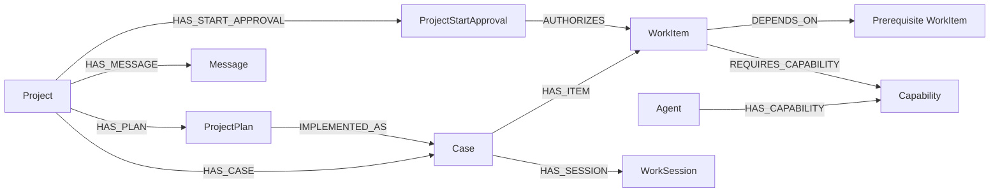
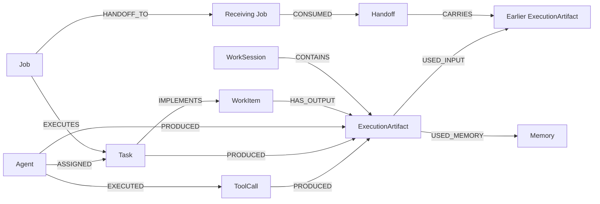
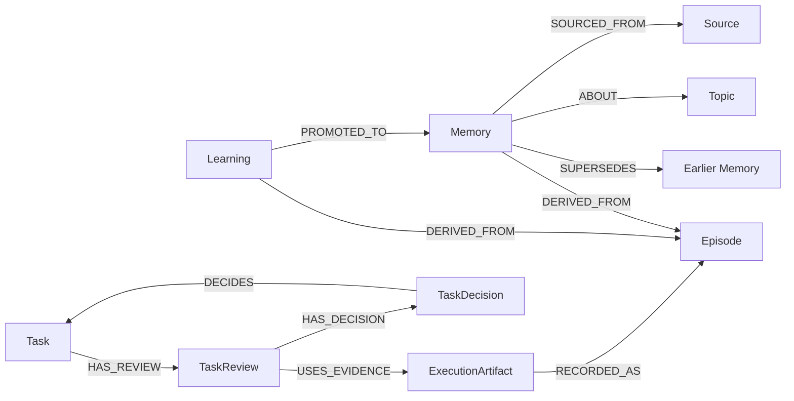

# FalkorDB graph data model

Relay's authoritative records are property-graph nodes and relationships in FalkorDB. There is no separate database file to commit with the source code. The supplied server persists graphs through its AOF/snapshot files in a Docker volume; application queries create the labels, indexes and records.

## Graphs and access boundaries

| Graph | Records |
| --- | --- |
| `relay_support_<tenant>` | Projects, plan versions, cases, work items, agent jobs, sessions, messages, execution artifacts, memory, reviews and decisions. |
| `relaykg_<tenant>_team` | Graphiti shared episodes, extracted entities, temporal facts, vectors and ingestion receipts. |
| `relaykg_<tenant>_user_<hash>` | One owner's private Graphiti knowledge; hash is the first 32 SHA-256 hex characters of the owner ID. |
| `relay_<tenant>` | Earlier compatibility API's separate memory/run records. The current Projects and Cases UI uses the support graph. |

The server derives tenant and actor from the bearer identity. Requests and models cannot choose a graph name. A team case is accessible within that tenant; a private case and its descendants require the owner. Shared recall searches team knowledge only. Private recall searches team knowledge plus the authenticated owner's private scope. Graph separation complements application authorization; a namespace string alone is not permission.

## Plans become real work

| Label | Important properties and purpose |
| --- | --- |
| `Project` | Stable project identity, owner/visibility, optimistic `revision`, current plan/case IDs and source identity. |
| `ProjectPlan` | Immutable validated plan JSON, version, fingerprint, source namespace and import provenance. |
| `ProjectRequest` | Actor-scoped idempotency receipt; repeats return saved results and conflicting payloads fail. |
| `Case` | One project attempt, `revision`, `project_revision`, `memory_revision`, current session and execution state. |
| `WorkItem` | Planned task key/title/requirements, capability, dependency state, execution state, current artifact and declared human owner. |
| `Capability` | An executable capability such as `write_document` or `test_page`, scoped to the case. |
| `Agent` | Available role and capability relationships, scoped to the case. |
| `ProjectStartApproval` | Explicit actor decision tied to task, plan, graph/memory revisions and execution generation. |

`DEPENDS_ON` points **from a task to its prerequisite**. `release → browser-tests → page → contract → requirements` means requirements must produce usable inputs before release can run. Dependency arrows do not mean chronological message flow.

An imported owner has `assigned_company_person_id`, `assigned_name`, `assignment_source_tenant` and related source metadata. This records declared responsibility; it is not Relay authentication and does not grant that person access. Case `owner` separately controls private scope. The optional Automate export preserves this distinction.

Up to 40 tasks and 80 edges are allowed per imported plan. Validation rejects cycles, duplicate IDs, missing prerequisites and unsupported capability identifiers. A revision creates a new plan and case attempt, supersedes the old attempt and requires fresh task-start approvals. Existing files remain in historical records.

## Execution, sessions and handoffs

`Job` holds its stage, status, claim token, lease expiration, attempt count, captured revisions and retry time. `Task` records the reviewable unit of agent work; it is distinct from the planned `WorkItem`. `ExecutionRun` groups an execution generation. `ToolCall` records the selected allowed tool and its outcome.

`ExecutionArtifact` contains the actual bounded text file contents as JSON, file hashes, validation checks, producing agent/session, exact prerequisite artifact IDs and memory/source version receipts. Files are served from these graph records; local downloads are copies, not the authoritative store. `Handoff` identifies producer, recipient and carried artifact; consumption records who received it and in which session.

`WorkSession` persists a period of work. Session relationships include `NEXT_SESSION`, `WORKED_ON` and `CARRIED_FORWARD` so reopening or explicitly starting a new session can retain unfinished work. A browser tab closing does not erase committed graph state.

## Memory and decisions

| Label | Meaning |
| --- | --- |
| `Episode` | Dated outcome/interaction evidence, source eligibility and Graphiti indexing status. |
| `Memory` | Current or historical episodic, semantic or procedural knowledge with provenance and revision. |
| `Learning` | Proposed reusable playbook. Human approval promotes it to procedural memory. |
| `Message`, `ChatRequest` | Saved conversation and deduplication receipts. Projects also use `ProjectRequest`. |
| `TaskReview`, `TaskEvidence` | AI recommendation and evidence, bound to the task/case versions and current sources. |
| `TaskDecision` | Explicit human approve/reject decision with actor, rationale and exact reviewed work. |
| `Gate`, `KnowledgeLease` | Native memory epoch and scoped indexing lease used to fence stale writes. |
| `Event` | Persisted workflow activity. |

Execution success, start consent and human acceptance are different facts:

- `ProjectStartApproval` authorizes an agent to perform a particular current task.
- `WorkItem.execution_status = "succeeded"` means the executor produced output and its checks passed.
- A current `TaskReview` is an AI recommendation.
- `TaskDecision` records human acceptance/rejection; only that reviewed path constitutes approved completion.

The scheduler may consume checked outputs before human completion approval, but new Projects still require explicit start approval for **each receiving task**.

## Recovery reasoning and Graphiti

Recovery adds `RecoveryRequest`, `Finding`, `RecoveryAction` and `WorkItemChange`. Scout, Coordinator and Reviewer use bounded tools over the same `WorkItem` dependencies and capability paths. A `Finding` connects a tool result, source entities, selected memories and a dated episode; a later session can reuse it only while its graph and memory receipts remain current. Actions connect to targeted work and assigned agents.

Each recovery case's work items also have a server-derived `Recovery_<case-hash>` label. This restricts native PageRank to that project's dependency topology. It is not a user-supplied Cypher label.

Graphiti, through `FalkorDriver`, stores `Episodic` and `Entity` nodes and temporal fact relationships in the selected knowledge graph. Relay adds `RelayEmbeddingConfig` to prevent mixing embedding configurations and `RelayEpisodeReceipt` to acknowledge completed ingestion and link SDK records to native case episodes. Extraction is not approval. Receipt, temporal-validity and native-source checks gate recalled facts before agents use them.

## Current evidence and safe concurrency

Claims and publication use conditional Cypher statements. A result must still match its claim token, lease, case/task/graph revisions, source eligibility and captured memory versions. Pause or a changed requirement can invalidate an in-flight computation. Model calls run outside database locks.

Workers can process different projects concurrently; one active job per case keeps its output sequence explicit. FalkorDB permits parallel reads and serializes writes within a graph. Relay does not claim unlimited parallel writes or exactly-once model calls. Interrupted work can repeat computation; native commits are fenced and Graphiti ingestion is at-least-once with deterministic episode IDs and durable receipts.

See [queries and algorithms](CYPHER_QUERIES.md), [architecture](ARCHITECTURE.md) and [local setup](LOCAL_SETUP.md).
